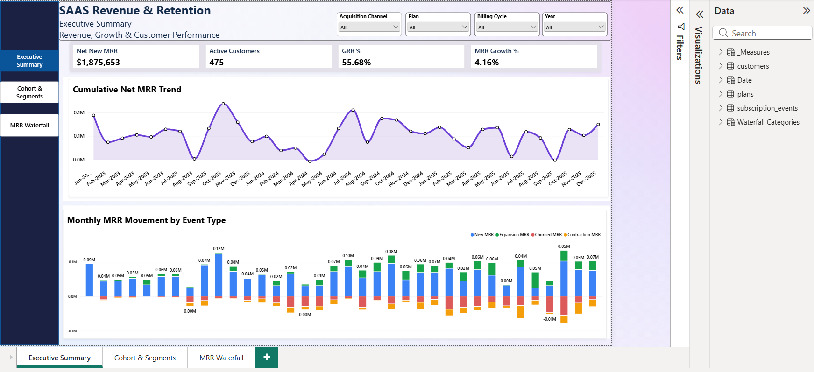
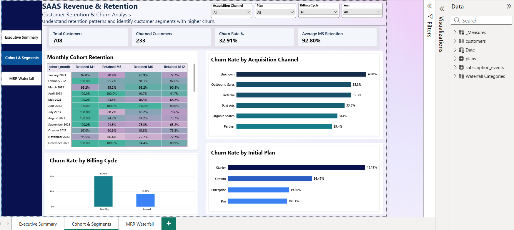
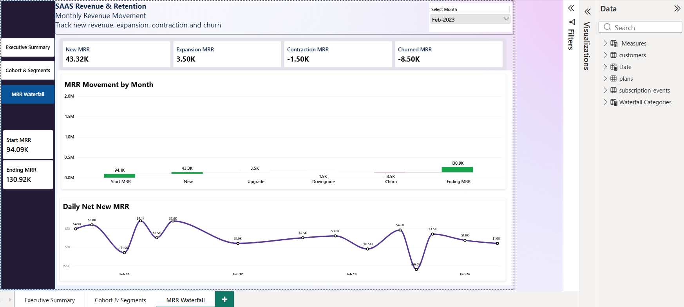

# SaaS Revenue & Retention Analytics

An end-to-end data analytics project focused on SaaS revenue performance, subscription movements, customer retention, and churn. This project uses **SQL, Python (Pandas), Excel, and Power BI** to transform subscription data into actionable business insights.

## Project Overview

Subscription-based businesses need to understand how recurring revenue changes, why customers churn, and which customer segments retain better over time.

This project explores customer and subscription event data to analyze Monthly Recurring Revenue (MRR), revenue growth, churn, and cohort retention. SQL is used for business analysis, Python and Pandas for data cleaning and exploration, and Power BI for interactive dashboards.

## Business Objectives

- Analyze monthly recurring revenue and revenue growth.
- Measure new, expansion, contraction, churned, and reactivated MRR.
- Identify customer segments with higher churn rates.
- Evaluate customer retention using cohort analysis.
- Compare churn across acquisition channels, subscription plans, and billing cycles.
- Present findings through interactive dashboards.

## Tools & Technologies

| Tool | Purpose |
|---|---|
| SQL (MySQL) | Data exploration, aggregations, CTEs, subqueries, and window functions |
| Python | Data analysis and exploratory data analysis |
| Pandas | Data cleaning, transformation, validation, and aggregation |
| NumPy | Conditional logic and data manipulation |
| Matplotlib / Seaborn | Exploratory data visualizations |
| Power BI | Interactive dashboards, data modeling, and KPI reporting |
| DAX | Revenue, churn, retention, and growth measures |
| Excel | Data cleaning, validation, and exploratory analysis |

## Project Workflow

1. **Data preparation:** Inspect the customer and subscription event datasets, check data quality, and address missing or duplicate records.
2. **SQL analysis:** Calculate revenue metrics, analyze subscription events, and investigate churn and retention patterns.
3. **Python and Pandas:** Perform exploratory analysis, validate records, transform data, and examine trends and customer segments.
4. **Power BI:** Build an interactive report to monitor revenue performance and explore customer retention.
5. **Business interpretation:** Use the analysis to identify patterns and potential areas for further investigation.

## Dashboard Preview

### 1. Executive Summary

Tracks revenue performance and customer activity.

- Net New MRR
- Active Customers
- Gross Revenue Retention (GRR)
- MRR Growth
- Cumulative MRR trend
- Monthly revenue movement by event type



### 2. Customer Retention & Churn Analysis

Explores customer retention and churn across different segments.

- Total and churned customers
- Churn rate
- Average Month 3 retention
- Monthly cohort retention
- Churn by acquisition channel
- Churn by initial plan and billing cycle



### 3. Monthly Revenue Movement

Breaks down the factors that contribute to changes in recurring revenue.

- Starting MRR
- New MRR
- Expansion MRR
- Contraction MRR
- Churned MRR
- Reactivation MRR
- Ending MRR
- Daily Net New MRR trend



## Key Analysis Areas

### SQL
- Revenue and subscription event analysis
- Monthly revenue trends
- Cumulative MRR using window functions
- Churn analysis by customer segment
- Gross and net revenue retention calculations
- CTEs, subqueries, aggregations, and window functions

### Python & Pandas
- Data inspection and exploratory data analysis
- Missing-value and duplicate checks
- Validation of customer and event relationships
- Conditional categorization and data transformation
- Revenue and churn summaries
- Trend analysis and visualizations

### Power BI
- Data modeling and table relationships
- DAX measures and calculated metrics
- Cohort retention matrix
- Churn and revenue dashboards
- Interactive slicers and cross-filtering
- KPI reporting and business-focused visual design

## Business Questions

This project is designed to answer questions such as:

- How does MRR change over time?
- Which subscription events contribute most to revenue growth or loss?
- Which subscription plans have higher churn?
- How does churn differ between monthly and annual billing?
- How does customer retention vary across signup cohorts?
- Which acquisition channels need further churn investigation?
- How much recurring revenue is recovered through reactivation?

## Repository Structure

```text
saas-revenue-retention-analytics/
│
├── README.md
├── SQL/
│   └── SQL analysis scripts
├── Python/
│   └── Pandas analysis notebooks or scripts
├── PowerBI/
│   └── SAAS_Revenue_Retention_Analysis.pbix
└── screenshots/
    ├── executive_summary.png
    ├── cohort_segment.png
    └── mrr_waterfall.png
```

*Adjust folder and file names to match the files you actually upload.*

## Skills Demonstrated

- SQL querying and business analysis
- Data cleaning and validation
- Python and Pandas data manipulation
- Exploratory data analysis (EDA)
- Revenue and subscription analytics
- Customer churn and cohort retention analysis
- DAX and Power BI dashboard development
- KPI interpretation and insight communication

## Conclusion

This project demonstrates an end-to-end analytics workflow, from data preparation and SQL analysis to Python-based exploration and Power BI reporting. It provides a structured way to investigate SaaS revenue movements, customer retention, and churn patterns to support data-driven decisions.

## Author

**Neena Sri Shankar**

- [LinkedIn Profile](https://www.linkedin.com/in/neena-sri-shankar-08313843b/)
- [GitHub Profile](https://github.com/sneena-sri)
